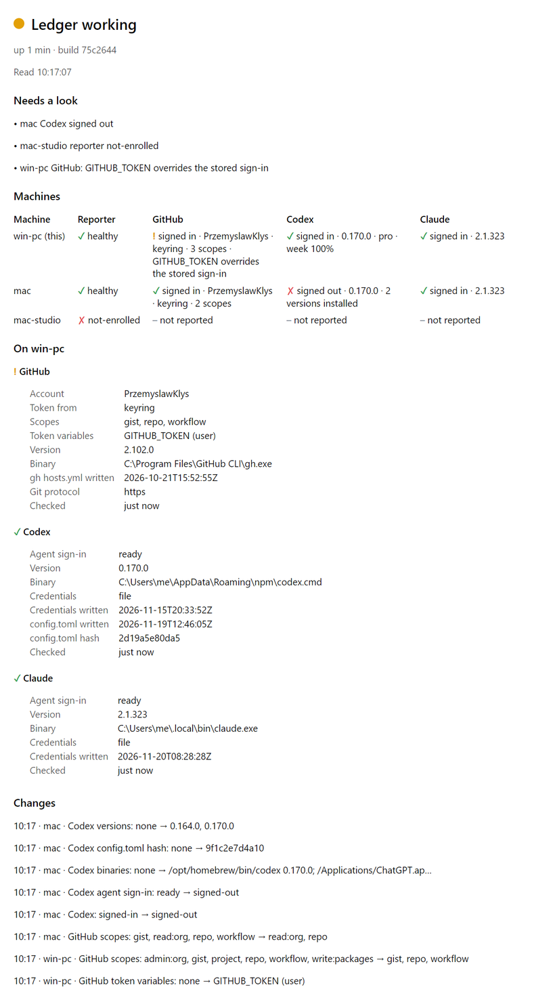
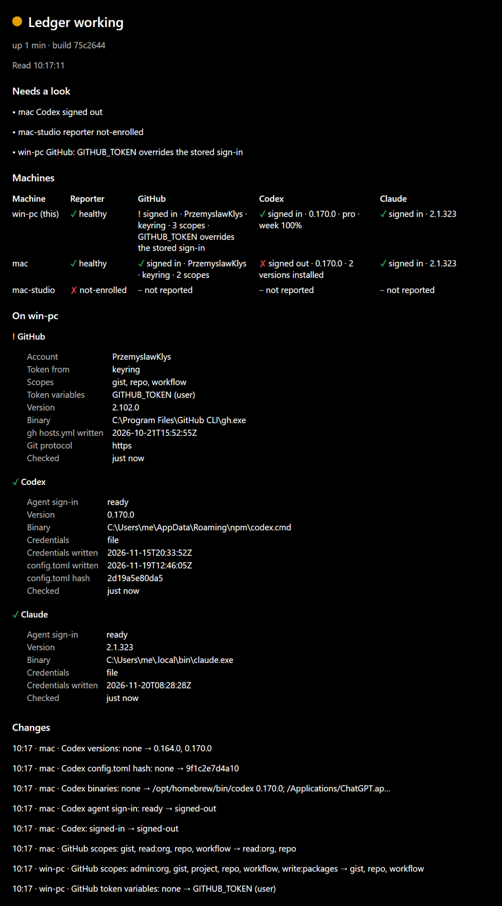

# Ledger tray

The IX Ledger tray sits in the Windows notification area and the macOS menu bar. It shows at a glance whether the
Ledger is running, whether each machine's reporter is sending, and whether GitHub, Codex and Claude are signed in on
each machine with the rights they need. It also keeps the history of what changed, so a sudden sign-out can be traced
to when it happened and what changed with it.

The tray only reads the Ledger. It never restarts or stops the service; restarts belong to the supervisor and deploys
to the deploy procedure in the Ledger runbook. It never signs in by itself: **Sign in to …** opens a terminal with the
provider's own sign-in command for you to complete.

**Show details…** (or a click on the icon) opens the full picture. The example below comes from a test instance
with one machine signed out of Codex and a token variable set on another:

| Light | Dark |
| --- | --- |
|  |  |

## The icon


| Dot | Meaning |
| --- | --- |
| Green | The Ledger answers its health check, every reporter is sending, and nothing below needs a look. |
| Amber | Something needs a look: a reporter is silent or not enrolled, a provider is signed out, a token variable overrides gh's stored sign-in, two different Codex or Claude versions are installed, or less than 10% of the GitHub REST budget is left. The first lines of the menu say which. |
| Red | The Ledger doesn't answer, or answers its health check with a stall. |
| Grey | The tray is still reading. |

## Provider marks

| Mark | Meaning |
| --- | --- |
| ✓ | Signed in. For Codex and Claude this comes from the agent service's own sign-in check on that machine. |
| ✗ | Signed out or the sign-in expired. For Codex it also shows when `auth.json` is gone and Codex keeps its sign-in in that file. |
| ! | Signed in, with something to check: a `GH_TOKEN` or `GITHUB_TOKEN` that overrides the stored gh sign-in, or more than one installed version. |
| ? | Unknown: the check timed out or couldn't run. |
| – | Not installed, or the machine's reporter doesn't send sign-in facts yet. |

Each provider line opens the facts behind it: the gh account, token source and scopes, the token variables that are
set (names only), every binary and its version, when `config.toml`, `hosts.yml` and the credential files were last
written, and a short hash of `config.toml` so a rewrite shows. Token values and credential files are never read.

## Where the facts come from

Each machine's reporter collects them every 15 minutes, and at once when a watched file or binary changes:
`gh auth status --json hosts`, each tool's `--version`, file times and the `config.toml` hash. `gh auth status` makes
one GitHub request per check, so about four an hour per machine. The reporter sends them with its health every minute,
and the Ledger records every difference from the previous reading as a change, with the agent service's sign-in state
folded in. Changes are kept for 90 days, at most 5,000.

`IntelligenceX.Ledger auth-check --config <reporter.json>` prints what this machine would send. The MCP tool and CLI
command `auth_state [machine]` read every machine's facts and the latest changes.

## Notifications

A notification appears for a change in sign-in state, account, scopes, token source or variables, installed
versions, credential store or the `config.toml` hash, once per change. File times and version upgrades stay in the
history only. The Ledger going down is announced after two failed reads in a row (two minutes), and its recovery once
it answers again. **Notify about changes** in the menu turns them off.

## Install

The tray ships in the Ledger kit (`tools/tray`) and installs from it with the rest of a deploy:

```powershell
./Install-LedgerTray.ps1 -Action Install -Kit <kit> -Apply
```

It goes to `ledger-tray/app` in the Ledger folder and starts at login (a Run value on Windows, a LaunchAgent on
macOS). It reads `client.json` from the Ledger folder: the endpoint, the read token and, over the network, the
certificate fingerprint. `IntelligenceX.Ledger.Tray snapshot` prints the menu as text, which is handy over SSH.
